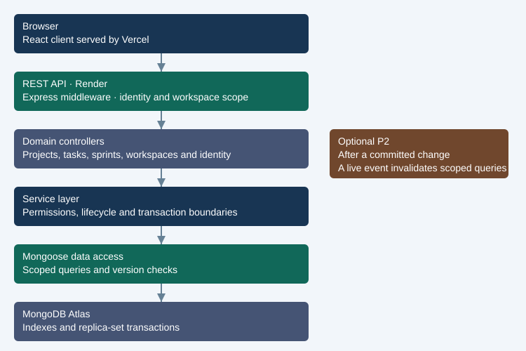
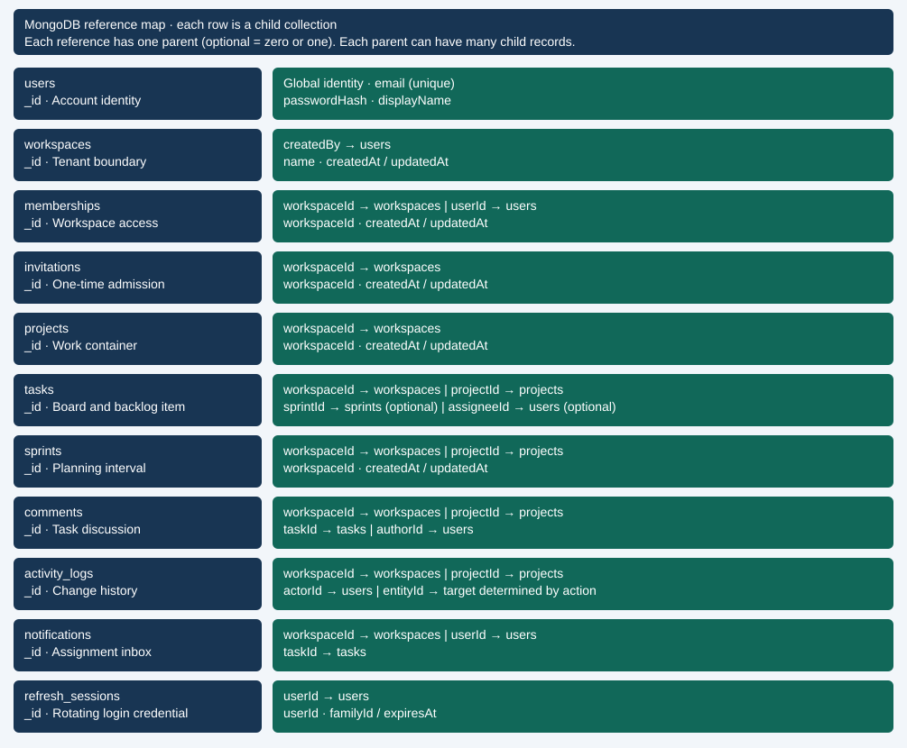
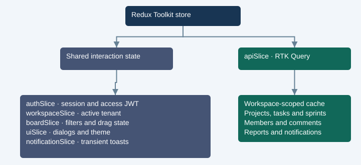

# TaskMatrix — Enterprise Agile Project Management Platform

TaskMatrix is a proposed agile project management platform for small engineering teams and internal delivery groups. Each task has one project record shared by the backlog, Kanban board and sprint dashboard. A delivery lead can plan the next sprint from that record, a contributor can update it, and a stakeholder can follow progress with read-only access.

**Current phase:** Planning and Architecture

**Designated track:** Full Stack Development (MERN), subject to mentor confirmation

## Table of contents

- [Product objectives](#product-objectives) and [success measures](#success-measures-and-non-functional-requirements)
- [Core features](#core-features) and [prioritized feature matrix](#prioritized-feature-matrix)
- [Workspace permissions](#workspace-permissions) and [core journeys](#core-journeys)
- [Technology stack](#technology-stack) and [architecture diagrams](#architecture-diagrams)
- [API contract](#api-contract) and [UI/UX design](#uiux-design)
- [Delivery plan](#delivery-plan) and [sprint submission checklist](#sprint-submission-checklist)

## Product objectives

- Reduce the time leads spend reconciling task ownership and sprint progress across spreadsheets and chat.
- Make unfinished work visible when a sprint closes so it can be considered during the next planning session.
- Let multiple teams use the same platform with independent workspace membership, permissions and project data.

## Success measures and non-functional requirements

Proposed release targets: four of five pilot users complete the invite-to-first-task flow unaided within five minutes. Every accepted task move survives a reload. All tenant-isolation tests pass. At 20 concurrent users on a seeded 1,000-task project, target p95 below 500 ms for paginated board reads, measured from the API boundary. Test keyboard operation, visible focus and screen-reader names on all core actions. No baseline has been measured.

## Core features

| Capability | What the team can do in the proposed MVP |
| --- | --- |
| Workspace access | An Owner creates a workspace, invites colleagues and delegates access through workspace roles. |
| Project and task management | Leads organize projects. Contributors create, assign and archive tasks, with one record shared across planning views. |
| Board and backlog | Contributors order work within each status and see which unfinished tasks still need a sprint. |
| Sprint planning and reporting | Leads start and close sprints. Viewers can inspect current task counts by project and status. |

## Prioritized feature matrix

P0 defines the minimum product for the four-week capstone. P1 adds collaboration, reporting and usability improvements once the core journey passes. P2 depends on remaining capacity.

| ID | Priority | User story and acceptance criterion |
| --- | --- | --- |
| FR-01 | P0 | As a new user I can register, sign in and sign out. A revoked session cannot refresh. |
| FR-02 | P0 | As a lead I can create a workspace. Its creation also creates my Owner membership. |
| FR-03 | P0 | As an Admin I can invite a colleague. Only the signed-in recipient with the matching email can redeem the invitation once. |
| FR-04 | P0 | As an Owner I can change a colleague’s role. The next protected request uses the new role. |
| FR-05 | P0 | As a lead I can create, rename and archive projects. Archived projects are read-only. |
| FR-06 | P0 | As a Member I can create, edit, assign and archive tasks. Assignment accepts a current workspace member with write access. |
| FR-07 | P0 | As a contributor I can move a task across board columns. Reload preserves its position and stale moves return a conflict. |
| FR-08 | P0 | As a planner I can see unarchived, unfinished tasks without a sprint in the project backlog. |
| FR-09 | P0 | As a lead I can plan, start and complete a sprint. Completion returns unfinished items to backlog and keeps finished items in sprint history. |
| FR-10 | P0 | As a Viewer I can see current project counts by status. Counts exclude archived tasks. |
| FR-11 | P1 | As a lead I can combine search, status and assignee filters and sort the resulting list. |
| FR-12 | P1 | As a Member I can post a comment and see it after reload. |
| FR-13 | P1 | As a lead I can trace a task change to an actor and timestamp. |
| FR-14 | P1 | As a planner I can see project status totals and open tasks per assignee including an unassigned bucket. |
| FR-15 | P1 | As an assignee I can see and acknowledge my own assignment notification. |
| FR-16 | P1 | As a keyboard or mobile user I can change task status through a menu and recover focus after closing a dialog. |
| FR-17 | P2 | As a lead I can inspect daily remaining work and compare completed work across sprints if historical snapshots are available. |
| FR-18 | P2 | As a collaborator I can see another user’s saved change without refreshing if live updates are enabled. |
| FR-19 | P2 | As a user I can select a dark theme that preserves readable contrast. |

## Workspace permissions

| Action | Owner | Admin | Member | Viewer |
| --- | --- | --- | --- | --- |
| Read workspace, projects, boards and reports | Yes | Yes | Yes | Yes |
| Create, edit, assign, move or archive tasks and add comments | Yes | Yes | Yes | — |
| Manage projects and sprints, invite or manage Members and Viewers | Yes | Yes | — | — |
| Manage Admins and workspace settings | Yes | — | — | — |
| Read or acknowledge own notifications | Yes | Yes | Yes | Yes |

One Owner per workspace in the capstone. Ownership is fixed. Admins cannot change themselves, other Admins or the Owner. Membership removal clears assignments in that workspace.

## Core journeys

1. Owner registers, creates a workspace and invites a colleague. The recipient signs in and accepts before expiry.
2. Admin creates a project and planned sprint. Members add tasks from the backlog. Admin starts the sprint.
3. Member assigns a task and moves it through TODO, IN_PROGRESS, IN_REVIEW and DONE. Viewer checks totals. Admin completes the sprint and reviews returned work.

## Technology stack

| Layer | Proposed choice and reason |
| --- | --- |
| Interface | React.js and TypeScript for typed views, Vite for builds, React Router for scoped pages, Tailwind CSS and shadcn/ui for consistent controls, Lucide Icons for labeled actions. |
| Interaction and data | Redux Toolkit for shared UI state, RTK Query for server data, dnd-kit for board movement and Recharts for analytics. |
| API | Node.js, Express.js and TypeScript in a modular monolith. REST controllers validate with Zod, services enforce business rules, and data-access modules use Mongoose. |
| Persistence | MongoDB Atlas for indexed tenant-scoped queries and multi-document transactions. Memberships link users to workspaces. |
| Security | bcrypt password hashes, JWT access tokens in memory, rotated refresh tokens in secure HttpOnly cookies, CSRF checks, rate limiting and membership-based authorization. |
| Verification and hosting | Vitest for unit tests, Supertest for API integration and Playwright for user journeys. Proposed hosts are Vercel, Render and Atlas. |

## Architecture diagrams

### System architecture

[System architecture](docs/system-architecture.md) · [Editable diagram](docs/diagrams/system-architecture.drawio)

### MongoDB reference model

[Database schema and transaction rules](docs/database-schema.md) · [Editable ERD](docs/diagrams/mongodb-erd.drawio)

### Frontend state ownership

[Frontend architecture](docs/frontend-architecture.md) · [Editable state tree](docs/diagrams/frontend-state-tree.drawio)

## API contract

The mock REST API uses `/api/v1`. Authentication establishes a session, workspace routes establish membership context, and nested project routes scope tasks and sprints. Board writes carry a version so two editors cannot silently overwrite a move. [Endpoint examples](docs/api-specification.md) · [OpenAPI contract](docs/openapi.yaml)

## UI/UX design

[TaskMatrix interactive prototype · Figma Make V2](https://www.figma.com/make/N8iFs7N6oWDtJYdBBl5mgf/Agile-Project-Management?t=idRCiG4NRHRbJ1Pp-1)

The interactive prototype uses simulated authentication and workspace data. The owner’s source review confirmed ten design views. Login and registration lead into the main dashboard and project management. A project brings together the Kanban board, sprint planning and backlog, task details, and analytics dashboard. Team management and settings cover workspace administration. The design system documents shared interface patterns.

[Design views and planned routes](docs/ui-ux.md) · [Detailed product rules](docs/product-requirements.md)

## Delivery plan

Week 1 establishes contracts and design. Week 2 delivers identity, workspaces and projects. Week 3 connects tasks, board, backlog and sprints. Week 4 gates deployment on access-control tests and end-to-end journeys. Analytics and enhancements depend on remaining capacity. [Roadmap and release gates](docs/development-roadmap.md) · [Security and testing](docs/security-and-testing.md) · [Decision records](docs/adr/)

Scope assumes a four-week team capstone and one active sprint per project. A late track change requires revisiting stack decisions. Reordering contention is handled by version checks and retries. Cross-site cookie restrictions require a same-site deployment test before release. Advanced integrations, AI assistants, billing and microservices are outside initial scope.

## Sprint submission checklist

| Submission priority | Deliverable | Status |
| --- | --- | --- |
| P0 | Public repository and primary PRD | Complete. The primary PRD is published on GitHub. |
| P1 | Public Figma design | V2 delivered and linked. Signed-out viewing requires manual confirmation. |
| P2 | Database, system and frontend state architecture | Complete. Three editable Draw.io files and their verified SVG exports are included. |

Submission priorities measure planning artifacts. Product priorities above determine implementation order.
